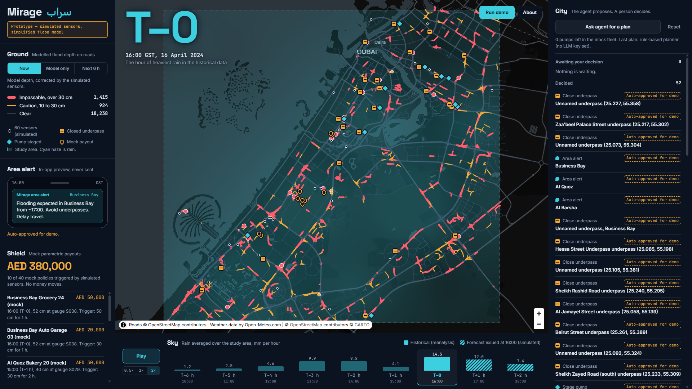
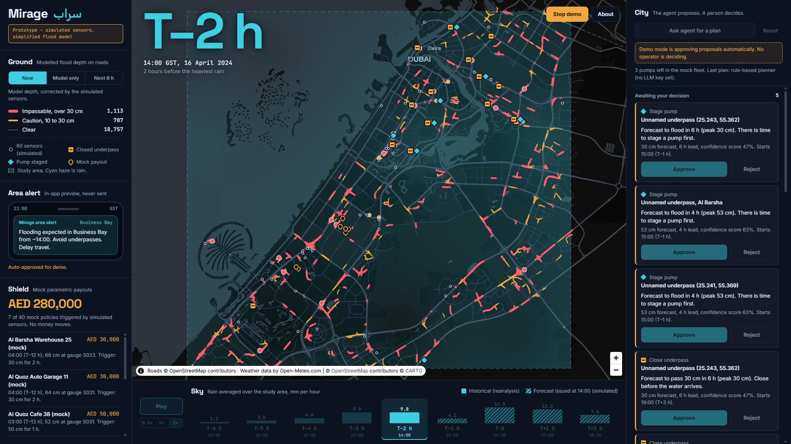

# Mirage (سراب)

**Prototype — simulated sensors, simplified flood model.**

**Live demo: https://thinkai-mirage.vercel.app**

Mirage is a student demo by Team Everglow for ThinkAI'26 (a Microsoft Imagine Cup preliminary). It replays the Dubai storm of **16 April 2024** hour by hour on one dark map and shows how a rain forecast could be turned into street-level flood action.

It is not an operational system. Nothing in it is connected to any real sensor, camera, alerting service, fleet or insurer.



## Contents

- [What it shows](#what-it-shows)
- [Try it in two minutes](#try-it-in-two-minutes)
- [Run it on your own machine](#run-it-on-your-own-machine)
- [Running with no internet](#running-with-no-internet)
- [How it works](#how-it-works)
- [The agent and Azure OpenAI](#the-agent-and-azure-openai)
- [What is real and what is simulated](#what-is-real-and-what-is-simulated)
- [Limits of the model](#limits-of-the-model)
- [The hosted demo](#the-hosted-demo)
- [Data credits](#data-credits)

## What it shows

| Engine | What you see |
|---|---|
| **Sky** | Historical rain for each hour (a reanalysis, see below), and a simulated forecast for the next 6 hours. |
| **Ground** | Modelled flood depth on about 20,000 road segments, corrected each hour by simulated sensor readings. |
| **City** | An agent (rule-based unless Azure OpenAI keys are set) proposes actions: stage a pump, close an underpass, send an area alert. A person clicks Approve or Reject. Nothing takes effect without approval. |
| **Shield** | When a simulated sensor in an insured zone measures enough water, a mock parametric payout fires. |

The timeline runs from T–6 h to T+2 h. T–0 is 16:00 Gulf Standard Time, the hour of heaviest rain in the historical data; it is computed from that data.

## Try it in two minutes

Open the [live demo](https://thinkai-mirage.vercel.app) and press **Run demo**. Or drive it yourself:

1. **Read the screen.** The large clock is the countdown to the heaviest rain. The bottom strip (Sky) is both the rain chart and the timeline: solid bars are historical data, hatched bars are the simulated forecast issued at the hour on screen. Click a bar to jump to that hour.
2. **Ask the agent.** Press **Ask agent for a plan** in the City panel. Proposals appear with the agent's reason and evidence.
3. **Decide.** Press **Approve** or **Reject** on each card. An approved closure or pump appears on the map; an approved alert appears in the phone preview. Decided actions collapse to one line; click one to read the reason again.
4. **Play forward.** Press **Play** (speeds 0.5×, 1×, 2×) and watch roads change colour and Shield payouts fire.
5. **Switch views** in the Ground panel: "Now" (model corrected by the simulated sensors), "Model only", and "Next 6 h" (worst forecast depth and forecast rain).
6. **Open About** for what is real, what is simulated, and the model's limits.

**Run demo** does steps 2 to 4 by itself: it resets, plays from T–6 h to T+2 h, and approves the agent's plan each hour. It takes about 90 to 100 seconds at 1× on a laptop and somewhat longer on the hosted site. Every action approved this way is labelled "Auto-approved for demo".



## Run it on your own machine

You need Python 3.11 or newer and Node.js 20.19 or newer (22.12 or newer on the 22 line). It was built and tested with Python 3.11 and Node 26 on Windows.

**1. Backend (first time only)**

```
cd backend
python -m venv .venv
.venv/Scripts/python -m pip install -r requirements.txt     (Windows)
.venv/bin/python -m pip install -r requirements.txt         (macOS / Linux)
```

**2. Data (first time only)**

The `data/` folder is not in the repository. Build it once:

```
cd backend
.venv/Scripts/python -m app.data_fetch all
```

This downloads rainfall, elevation and roads and caches them in `data/`. The elevation service has a free quota of roughly 5,000 points per hour, and the grid needs 6,075, so the fetch pauses and resumes; allow over an hour. After that the demo needs no internet for its data.

**3. Start it**

```
python start.py
```

This builds the frontend if it is missing or out of date, starts one server on port 8000 that serves both the API and the app, and opens http://localhost:8000 in your browser. The first start builds the replay and caches it in `data/timeline.npz`. Press Ctrl+C to stop.

- `python start.py --offline` opens the app with the online basemap switched off.
- `python start.py --no-browser` does not open a browser.

For development with hot reload, run the two servers separately instead: `.venv/Scripts/python -m uvicorn app.main:app --port 8000` in `backend/`, and `npm run dev` in `frontend/` (then open http://localhost:5173).

**4. Tests**

```
cd backend
.venv/Scripts/python -m pytest
```

There are 124 backend tests. They cover the grid and interpolation, the flood routing (water is lost only through drainage), the payout trigger, planner validation, and the rule that nothing takes effect without approval. There are no automated frontend tests; the screen is checked by running it.

## Running with no internet

Once `data/` exists and the frontend has been built once, the local demo needs no internet:

- All data comes from the `data/` cache. The fonts are bundled with the app.
- The only thing fetched at run time is the CARTO basemap. If it cannot be reached, the app falls back to a plain dark background with our cached road layer and labels for the three focus districts.
- **On venue Wi-Fi that is slow rather than absent, use `python start.py --offline`.** The automatic fallback only triggers when the basemap style cannot be fetched at all within 4 seconds; on a flaky connection the style can load and its tiles then arrive slowly or not at all.

This was checked by blocking every request that was not to localhost and running Demo mode end to end. That check blocks the browser's requests; it is not the same as switching Wi-Fi off, though the backend makes no outside requests unless Azure OpenAI keys are set.

## How it works

```
 Open-Meteo archive ──► Sky ────► rain per grid cell, per hour
 (historical rain)       │        + simulated forecast for +1..+6 h
                         ▼
 Open-Meteo elevation ─► Ground ─► water depth per cell ─► depth per road segment
 OpenStreetMap roads     ▲  │
                         │  └──────────────► City ──► proposals ──► a person approves
 Simulated sensors ──────┘ (correction)       ▲                         │
        │                                     └── approved pumps ◄──────┘
        └──► Shield ──► mock payout when a gauge crosses a policy's trigger
```

- **Sky** (`backend/app/sky.py`). Rain is interpolated onto a grid of about 200 m cells. A forecast issued at hour h for hour h+k is the historical field for h+k, blurred and perturbed with noise that grows with k. The random seed is fixed, so every replay is identical.
- **Ground** (`ground.py`). Each hour the model adds rain to every cell, moves part of the water to the lowest of the 8 neighbours over a few sub-steps, removes a fixed drainage rate, and clamps at zero. A road segment's depth is the deepest cell it crosses. Where a simulated sensor exists, the model cell is pulled toward the sensor's reading.
- **Sensors** (`sensors.py`). 60 simulated depth sensors read a second run of the same model driven by the historical rain, with noise added.
- **City** (`city.py`). A `Planner` receives the at-risk roads and districts, the mock pump fleet and the current actions, and returns proposals. `RulePlanner` is deterministic; `LLMPlanner` uses Azure OpenAI and falls back to the rules if its output fails validation. Every proposal waits in a queue. Only an explicit approve call changes its status.
- **Shield** (`shield.py`). 40 mock policies, each tied to the nearest gauge in its district. The trigger reads sensor readings only, never the forecast or the model.
- **Replay** (`replay.py`). The whole day is computed once and cached, so each hour loads instantly. Approving a pump re-runs the day with extra drainage at that site.

Real systems we cannot access (weather radar, traffic cameras, public alerting) sit behind three interfaces, `RainSource`, `DepthSensorSource` and `AlertChannel`, each with a simulated implementation, so a real source could be swapped in later.

### Repository layout

```
start.py              one command to run everything locally
backend/app/          FastAPI app and the four engines
backend/tests/        pytest suite
frontend/src/         React + TypeScript + MapLibre GL
api/index.py          entry point used only by the Vercel deployment
data/                 generated cache (not in git)
PROJECT_LOG.md        phase-by-phase record of what was built and decided
CLAUDE.md             the project spec
```

### API

| Route | What it returns |
|---|---|
| `GET /api/meta` | Study area, grid, story window, thresholds, districts, mock policies, hourly rain means, disclaimer. |
| `GET /api/roads` | Road segments as GeoJSON, once. |
| `GET /api/replay/{hour}` | Everything the screen needs for one hour: rain, forecast, road risk classes, sensor readings, the action queue, alerts, payouts. |
| `POST /api/plan/{hour}` | Runs the planner and queues its proposals. |
| `POST /api/actions/{id}/approve`, `/reject` | Records a decision. `?by=demo_auto` marks a Demo mode approval. |
| `POST /api/reset` | Clears the queue and restores the baseline. |

## The agent and Azure OpenAI

With no keys set, the agent is a deterministic rule-based planner, so the demo always has a planner available. The hosted demo runs this way.

To use Azure OpenAI instead, set these environment variables in the terminal that starts the backend (the app does not read a `.env` file by itself; `.env.example` lists the names), and install `openai` (it is in `backend/requirements.txt`):

```
AZURE_OPENAI_ENDPOINT
AZURE_OPENAI_API_KEY
AZURE_OPENAI_DEPLOYMENT
```

The LLM's plan is validated against the same rules. If it fails validation, or the call fails, the rule-based planner is used and the screen says so. The LLM path has unit tests but has **not** been run against a live Azure key.

## What is real and what is simulated

**Real**

- Hourly rainfall for 16 April 2024, from the Open-Meteo historical archive. This is a reanalysis: a model-based reconstruction of the weather, not rain-gauge or radar readings.
- Ground elevation, from the Open-Meteo elevation API.
- Roads, tunnels and underpasses, from OpenStreetMap through the Overpass API.

**Simulated**

- **The rain forecast.** It is the historical field, blurred and perturbed with noise that grows with lead time. It is not a real nowcast.
- **All depth sensors.** No real camera or gauge is involved.
- **Pumps, tankers and depots.** A mock fleet of 12 pumps and 6 tankers.
- **Insurance.** All 40 policies, businesses, triggers, amounts and payouts are invented. No money moves.
- **Alerts.** They are shown inside the app only and are never sent anywhere.

We have no access to NCM radar, RTA cameras or NCEMA systems, and the code does not scrape or imitate them.

## Limits of the model

- **The flood model is a simplified surrogate, not a hydraulic model.** It has no pipes, no culverts, no buildings and no flow physics. Its parameters are assumptions; it is not calibrated against observed flooding.
- **Depths are indicative only.** The model piles water into low cells, so deep values are shown as "over 100 cm".
- **Rainfall is understated.** The archive has cells 7 to 8 km wide. It gives about 106 mm over the area for the day and understates the true peak of this storm. `RAIN_SCALE` (default 1.0, an environment variable) multiplies the historical field if you want to explore heavier rain; any value other than 1.0 is no longer the historical data.
- **Elevation is coarse.** It was sampled every 400 m in whole metres and interpolated. It cannot see underpasses, so a 3 m dip is assumed wherever OpenStreetMap tags a tunnel or a negative layer.
- **The "truth" the sensors read is the same model.** Sensor correction therefore shows the mechanism, not real forecast skill.
- **Payouts carry basis risk.** A policy is paid on its nearest gauge, typically about 1 km away, not on the water at the business's door. Readings are hourly snapshots.
- **The confidence score on a proposal is not a probability.** It is a fixed function of lead time (95% minus 8 points per hour of lead), not calibrated against anything.
- **Pumps did not change any payout in our runs.** A full Demo mode run ends with the same AED 380,000 of mock payouts as a run with no actions.
- **Approved actions have simple effects.** A pump adds local drainage; a closure is drawn on the map. Traffic is not modelled.

## The hosted demo

https://thinkai-mirage.vercel.app runs the same code on Vercel: the frontend as static files and the FastAPI app as one serverless function, reading the same cached `data/` files. A full Demo mode run was checked there end to end.

Three things differ from a local run, and matter if several people open the link:

- **Everyone shares one action queue.** There are no user accounts or sessions. If two people use the site at once, they see and change the same proposals, and one person's Reset or Run demo clears the other's.
- **The queue can reset by itself.** It lives in the memory of the running function. After a quiet period Vercel stops the function, and the next visit starts from a clean replay. Under heavier traffic Vercel may also run more than one copy, each with its own queue.
- **It needs internet,** and responses are slower than on a laptop.

For a judged presentation, run it locally with `python start.py`; use the link for people who want to try it afterwards.

To redeploy after a change: `vercel deploy --prod` from the repository root. The `data/` cache must exist locally, because it is uploaded with the deployment (see `.vercelignore`); it is not in git.

## Data credits

- Weather and elevation data by [Open-Meteo.com](https://open-meteo.com/), licensed CC BY 4.0.
- Roads © [OpenStreetMap](https://www.openstreetmap.org/copyright) contributors, licensed ODbL.
- Basemap © [CARTO](https://carto.com/attributions), © OpenStreetMap contributors.
- Fonts: Inter, Space Grotesk and JetBrains Mono (SIL Open Font License), bundled through Fontsource.

## More detail

`PROJECT_LOG.md` is a phase-by-phase record of what was built, what went wrong and what was decided. `CLAUDE.md` is the project spec.
